# Lab2Web: Praktikum 2 HTML Lanjutan

Praktikum Pemrograman Web, Pertemuan 3.

- Nama: Laurensius Rivaldo Nahak
- NIM: 312310727
- Kelas: I251D

## 1. Tujuan

1. Memahami penggunaan tabel pada HTML.
2. Memahami penggunaan form dan berbagai jenis input HTML.
3. Menerapkan semantic HTML untuk menyusun struktur halaman.
4. Menambahkan elemen multimedia pada halaman web.
5. Menerapkan validasi form dasar menggunakan atribut HTML.

## 2. Struktur File

```
Lab2Web/
├── index.html        # Langkah 1-8 (tabel, form, validasi, semantic, multimedia)
├── biodata.html      # Proyek mini: Form Biodata Mahasiswa
├── media/
│   ├── audio.mp3
│   ├── video.mp4
│   └── video.webm    # cadangan format video untuk browser tanpa dukungan H.264
├── screenshots/
└── README.md
```

## 3. Cara Menjalankan

1. Clone atau unduh repository ini.
2. Buka `index.html` di browser (klik dua kali atau dari VS Code dengan Live Server).
3. Buka `biodata.html` untuk proyek mini, atau lewat menu "Proyek Mini: Biodata" pada `index.html`.

Tidak perlu instalasi. Berkas `audio.mp3` dan `video.mp4` adalah media contoh yang dibuat sendiri (nada sederhana dan video teks 5 detik).

## 4. Catatan Penulisan

- Satu halaman memuat beberapa form, sehingga atribut `id` diberi awalan agar unik (`reg-nama`, `val-email`, `bio-prodi`, dan seterusnya). Dengan begitu setiap `<label for="...">` terhubung ke input yang benar.
- Elemen `<video>` memiliki dua `<source>` (mp4 dan webm). Browser memilih format yang didukungnya.
- Ada sedikit CSS di dalam `<style>` hanya untuk merapikan tampilan dan memberi garis merah pada input yang tidak valid (`:user-invalid`). Seluruh validasi tetap memakai atribut HTML, tanpa JavaScript.
- Form tidak memiliki `action`, sehingga tombol kirim hanya memuat ulang halaman setelah validasi lolos.

## 5. Langkah Kerja dan Hasil

### Langkah 1: Tabel Data Mahasiswa

Tabel dibuat dengan `<table>`, `<tr>`, `<th>`, dan `<td>`. Data ditambah menjadi empat mahasiswa (minimal tiga).

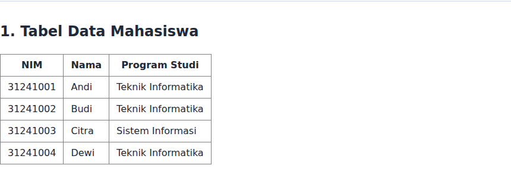

### Langkah 2: thead, tbody, tfoot, caption, dan colspan

Tabel nilai memakai `<caption>`, `<thead>`, `<tbody>`, dan `<tfoot>`. Eksperimen: ditambahkan baris ketiga (Citra, 88), rata-rata menjadi (85 + 90 + 88) / 3 = 87,67, dan sel "Rata-rata" memakai `colspan="2"`.

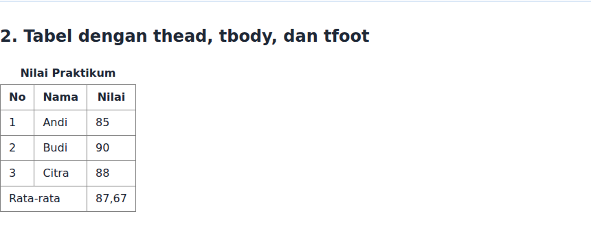

### Langkah 3: Form Registrasi Mahasiswa

Form berisi input `text`, `email`, `password`, dan `date`, serta tombol `submit` dan `reset`. Setiap input memiliki `<label>` yang terhubung lewat `for` dan `id`.

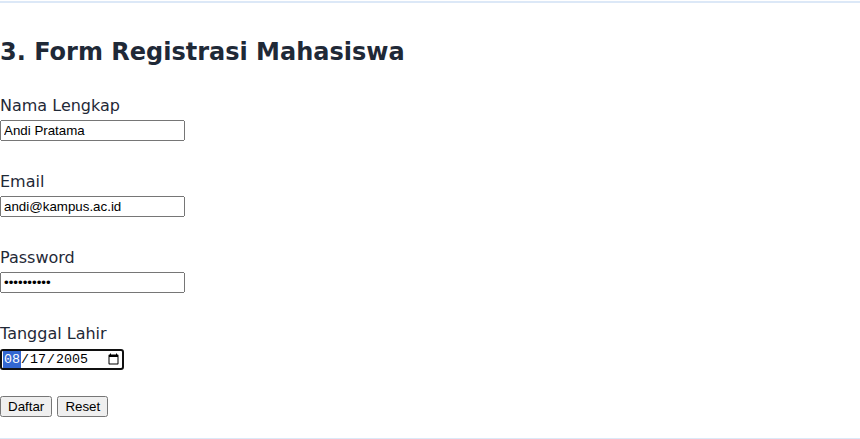

### Langkah 4: Radio Button dan Checkbox

Radio button memakai `name` yang sama (`jk`), sehingga hanya satu yang bisa dipilih. Checkbox memiliki `name` sama tetapi boleh dipilih lebih dari satu.

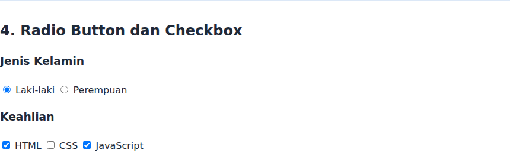

### Langkah 5: Select dan Textarea

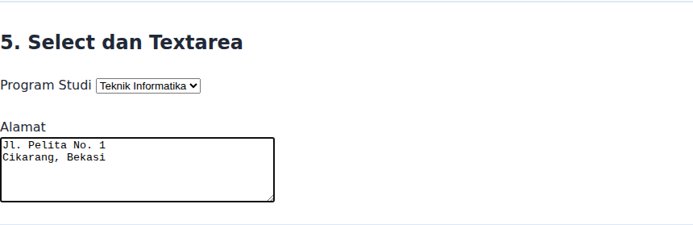

### Langkah 6: Validasi Form Dasar

Atribut yang dipakai: `required`, `minlength="3"`, `type="email"`, `type="number"`, `min="17"`, dan `max="60"`. Pesan di bawah ini berasal dari browser (Chrome, bahasa Inggris), bahasanya mengikuti pengaturan browser.

| Kondisi | Pesan dari browser |
|---|---|
| Semua kosong | "Please fill out this field." |
| Nama `Al` | "Please lengthen this text to 3 characters or more (you are currently using 2 characters)." |
| Email `andi` | "Please include an '@' in the email address. 'andi' is missing an '@'." |
| Umur `15` | "Value must be greater than or equal to 17." |
| Semua valid | Form lolos validasi dan dikirim |

| Kondisi | Screenshot |
|---|---|
| Kirim tanpa mengisi data | 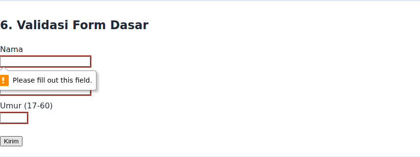 |
| Nama, email, dan umur salah | 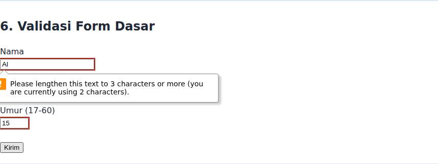 |
| Semua isian valid | 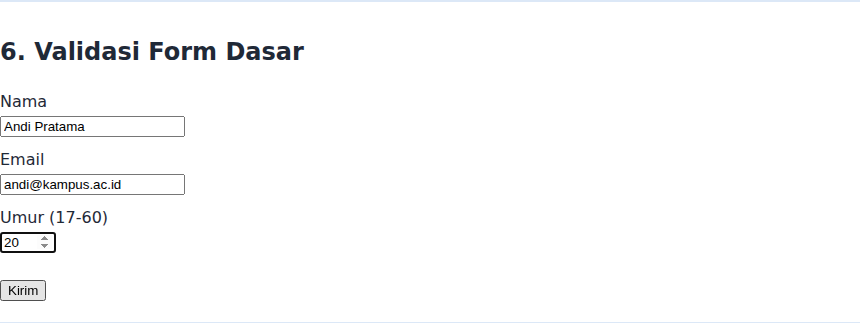 |

### Langkah 7: Semantic HTML

Seluruh halaman memakai `<header>`, `<nav>`, `<main>`, `<section>`, `<article>`, `<aside>`, dan `<footer>`. Bagian di bawah ini menampilkan `<article>` dan `<aside>`.

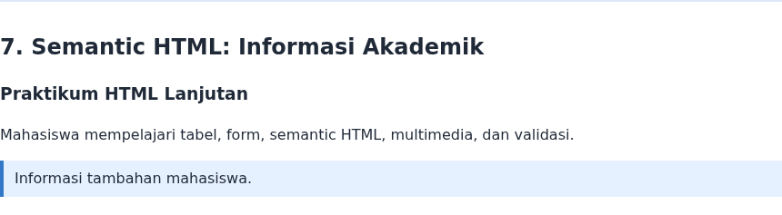

Tampilan halaman `index.html` secara keseluruhan:

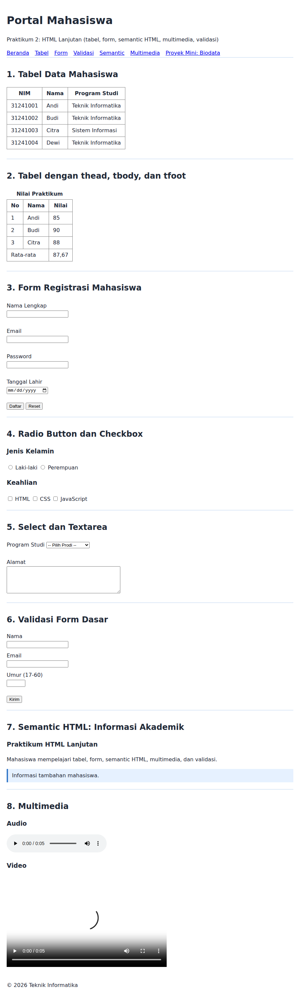

### Langkah 8: Multimedia

Elemen `<audio controls>` dan `<video controls width="480">` dengan teks cadangan jika browser tidak mendukung.

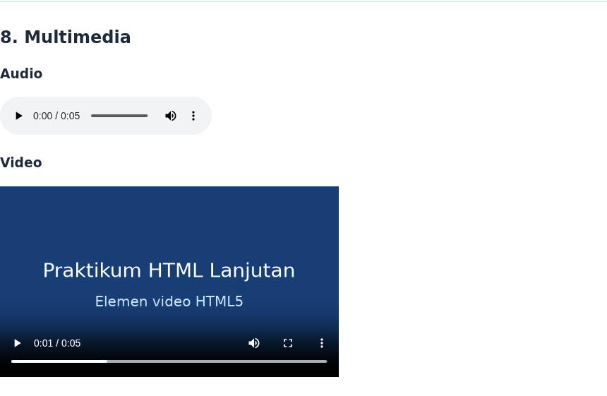

### Langkah 9: Proyek Mini, Form Biodata Mahasiswa

`biodata.html` menggabungkan semantic structure, tabel data, form dengan validasi dasar (`required`, `minlength`, `type="email"`, select wajib dipilih, textarea wajib diisi), dan satu elemen multimedia (video).

| Kondisi | Screenshot |
|---|---|
| Tampilan halaman penuh | 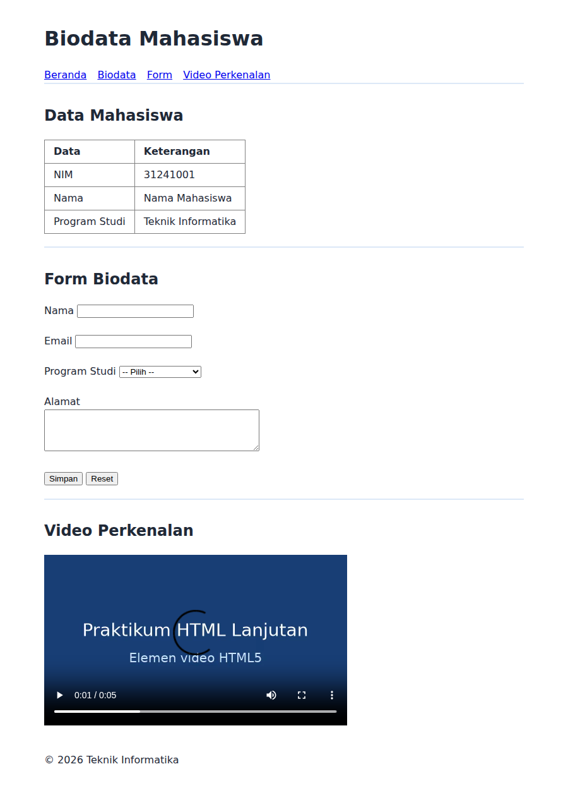 |
| Kirim form kosong | 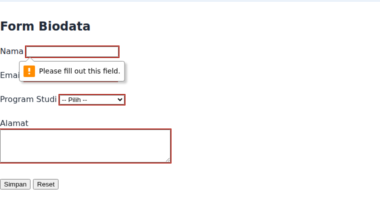 |
| Form terisi valid | 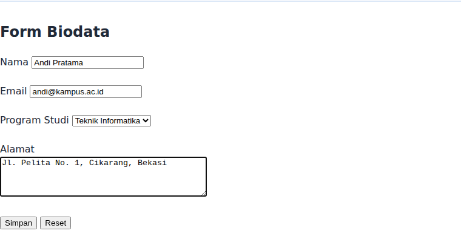 |

## 6. Jawaban Pertanyaan

1. `<table>` membuat struktur tabel, `<tr>` membuat baris, `<th>` membuat sel header, dan `<td>` membuat sel data.
2. `<th>` adalah sel header (teks tebal dan rata tengah secara bawaan, serta bermakna sebagai judul kolom/baris), sedangkan `<td>` adalah sel data biasa.
3. `colspan` menggabungkan beberapa kolom menjadi satu sel. Contohnya `colspan="2"` pada sel "Rata-rata".
4. `<form>` mengelompokkan kontrol input dan mengirim datanya ke server (atau diproses JavaScript) saat dikirim.
5. Radio button hanya mengizinkan satu pilihan dalam satu grup (`name` yang sama), sedangkan checkbox mengizinkan satu atau beberapa pilihan.
6. `<label for="id">` yang terhubung dengan `id` input membuat klik pada label memfokuskan input dan membantu pembaca layar membacakan label field tersebut.
7. `<textarea>` untuk teks beberapa baris (misalnya alamat) dengan ukuran `rows` dan `cols`, sedangkan `<input type="text">` hanya satu baris.
8. Semantic HTML memberi makna pada struktur halaman: `<header>` kepala halaman, `<nav>` navigasi, `<main>` konten utama, `<section>` kelompok konten, `<article>` konten mandiri, `<aside>` konten pelengkap, dan `<footer>` kaki halaman. Hasilnya lebih mudah dibaca, lebih ramah aksesibilitas, dan lebih baik untuk SEO.
9. `required` mewajibkan input diisi, `min` dan `max` membatasi nilai angka minimum dan maksimum, dan `minlength` membatasi panjang teks minimum.
10. `<audio>` memutar suara saja, sedangkan `<video>` memutar gambar bergerak beserta suara dan dapat diatur ukurannya (misalnya `width`).

## 7. Checklist

- [x] Tabel berhasil ditampilkan dan memiliki header yang sesuai
- [x] Form memiliki label dan beberapa jenis input
- [x] Radio button dan checkbox sudah digunakan
- [x] Select dan textarea sudah digunakan
- [x] Validasi `required` dan validasi dasar lainnya sudah dicoba
- [x] Semantic HTML sudah digunakan
- [x] Audio dan video berhasil ditampilkan
- [x] Proyek mini biodata menggabungkan materi utama
- [x] Screenshot dan README.md tersedia
- [ ] Repository di-commit dan URL dikirim ke e-learning
